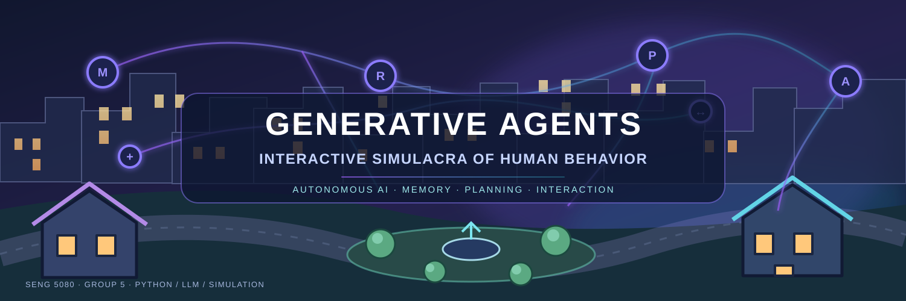
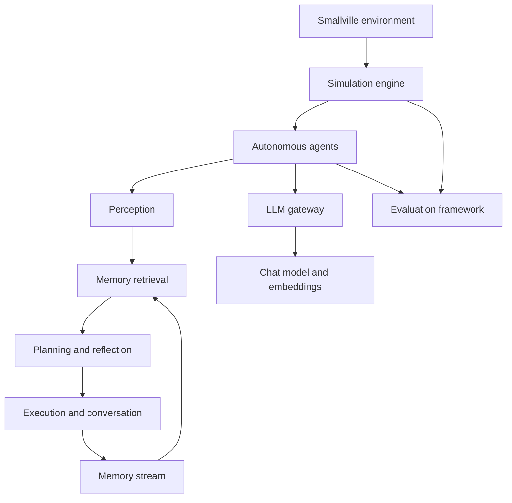
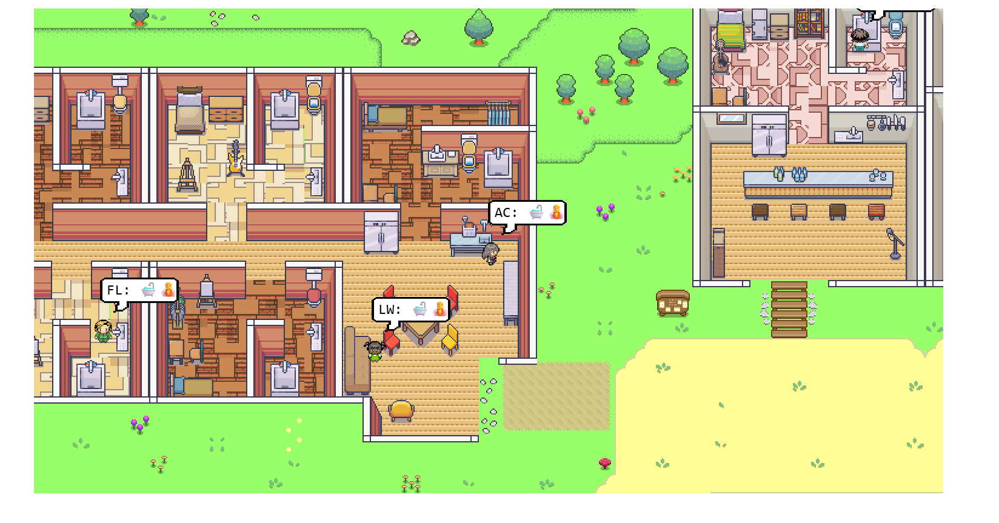
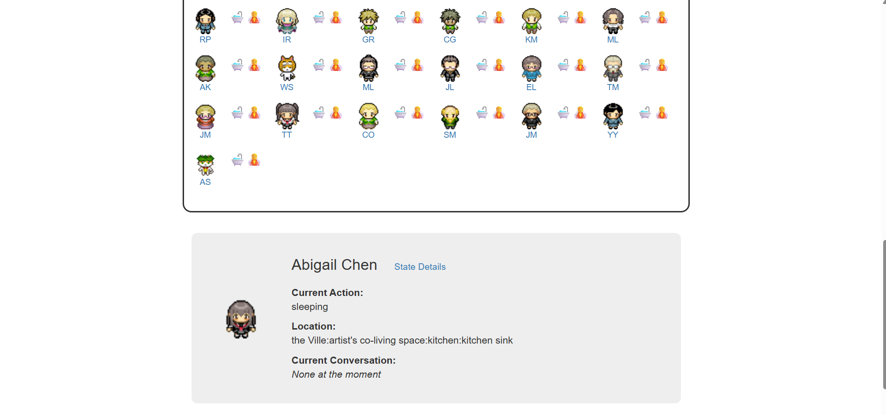

# Generative Agents: Interactive Simulacra of Human Behavior

A Python reimplementation and experimental extension of the Generative Agents research project. This academic project explores how autonomous agents store and retrieve memories, form plans, reflect on experiences, and interact in a simulated Smallville environment.

**Course project:** SENG 5080 · Group 5

This repository is based on the original research and implementation by Joon Sung Park and collaborators. The original implementation and modified files are identified in [NOTICE](NOTICE).

## Research background

**Generative Agents: Interactive Simulacra of Human Behavior**  
Joon Sung Park, Joseph C. O'Brien, Carrie J. Cai, Meredith Ringel Morris, Percy Liang, and Michael S. Bernstein · UIST 2023.

- [Research paper (arXiv:2304.03442)](https://arxiv.org/abs/2304.03442)
- [Original implementation](https://github.com/joonspk-research/generative_agents)

The simulation uses 25 agents, the authors' Smallville map and persona data, and a two-game-day timeline. The implementation adapts the original code to a current OpenAI API and a headless simulation workflow. See the comparison below and the [NOTICE](NOTICE) file for specific changes.

## What this project explores

- **Autonomous agents:** individual personas, relationships, memories, plans, and actions.
- **Memory stream and retrieval:** retrieval based on recency, importance, and relevance.
- **Reflection and planning:** agents form higher-level reflections and plan future actions.
- **Conversation and interaction:** agents react and communicate using the original project prompts.
- **LLM integration:** a gateway for model calls, caching, cost tracking, budgets, and mock runs.
- **Evaluation:** recall experiments and simulation-level measures.

## Experimental memory improvements

The project includes four optional memory fixes in `reverie/memory_fix.py`. They are **off by default**; enable them with `--memory-fix`.

| Fix | Observed issue | Experimental change |
| --- | --- | --- |
| **A — time-aware recency** | The original list-position calculation does not represent elapsed game time. | Uses decay raised to the number of game hours since the memory was last retrieved. |
| **B — keyword relevance** | Semantic similarity can miss exact names, dates, and times. | Adds word-for-word keyword matching to the retrieval score. |
| **C — factual consistency** | Generated conversation lines may contain unsupported details. | Checks each line against the memories it was based on before it is spoken. |
| **D — fact-level conversation memory** | A conversation saved as one short summary can hide details from later retrieval. | Saves individual facts from the conversation as linked memories. |

These are experimental changes documented in the code and NOTICE; the repository does not claim that they improve every task or metric. Use the evaluation commands below to compare behavior.

## How this differs from the paper's setup

| Research setup | This implementation |
| --- | --- |
| Retired completion/chat models | A configurable current chat model (default described in the original project README as `gpt-4o-mini`) |
| `text-embedding-ada-002` | `text-embedding-3-small`, configurable |
| Completion endpoint prompts | Original prompts adapted to a chat-model continuation instruction |
| Phaser browser frontend | Headless backend simulation; optional replay viewer |
| Human raters for end-to-end measures | LLM judge for the end-to-end measures |

The project follows the original authors' map, agent data, and prompts where noted. See [NOTICE](NOTICE) for file-level modifications and attribution.

## Architecture

The following diagram summarizes the main conceptual flow. It is a high-level view, not a complete call graph.



## Repository structure

```text
Generative-AI/
├── frontend/          # Replay viewer
├── reverie/
│   ├── persona/       # Agent cognitive modules and memory structures
│   ├── reverie.py     # Simulation loop
│   ├── maze.py        # Smallville map, tiles, and events
│   ├── path_finder.py # Movement and path finding
│   ├── llm_gateway.py # Model calls, cache, cost, budget, and mock mode
│   └── memory_fix.py  # Optional experimental memory fixes A–D
├── main.py            # Command-line interface
├── evaluation.py      # Evaluation measures
├── pyproject.toml     # Python project metadata and dependencies
├── NOTICE             # Original project attribution and modification record
└── README.md
```

## Getting started

### Prerequisites

- Python 3.12 or newer (the project metadata requires `>=3.12`; the original tested workflow below uses Python 3.15).
- [uv](https://docs.astral.sh/uv/) package manager.
- An OpenAI API key for real model-backed runs. Mock mode can be used without a paid API call.

### Install (Windows PowerShell)

```powershell
git clone https://github.com/Srinithinsara/Generative-AI.git
cd Generative-AI

uv venv .venv --python 3.15
uv pip install --python .venv\Scripts\python.exe -r pyproject.toml
```

Initialize the environment data:

```powershell
.venv\Scripts\python.exe main.py setup
```

### Run a free mock simulation

This command uses mock responses and does not require an API key:

```powershell
.venv\Scripts\python.exe main.py run --sim practice --mock --hours 2
```

### Run with an LLM

Set your API key for the current PowerShell session. Never commit API keys or other credentials:

```powershell
$env:OPENAI_API_KEY = "your-api-key"
```

Start with a short run and review the cost before running a longer simulation:

```powershell
.venv\Scripts\python.exe main.py run --sim full --hours 1
```

To continue the same simulation:

```powershell
.venv\Scripts\python.exe main.py run --sim full
```

### Evaluate memory recall and simulation results

```powershell
# Recall test without the experimental fixes
.venv\Scripts\python.exe main.py evaluate --sim before --recall-only

# Recall test with selected fixes
.venv\Scripts\python.exe main.py evaluate --sim before --recall-only --memory-fix A,D,B

# Evaluate the saved run
.venv\Scripts\python.exe main.py evaluate --sim before

# Compare with all four fixes enabled
.venv\Scripts\python.exe main.py evaluate --sim before --memory-fix A,B,C,D
```

### Replay viewer

The repository includes an adapted replay viewer. Download the required assets, export a replay, and start the viewer:

```powershell
.venv\Scripts\python.exe main.py setup --viewer
.venv\Scripts\python.exe main.py export-replay --sim full
.venv\Scripts\python.exe main.py viewer
```

Open `http://127.0.0.1:8000/` in a browser. A replay URL follows the form `/demo/<sim>/<start step>/<speed>/`.

## Configuration and cost awareness

- Mock mode is available for a practice run without real model calls.
- Real model-backed runs require a valid API key.
- The LLM gateway records calls and cost information and supports a configurable budget.
- Simulation logs, cached responses, and evaluation outputs are generated locally and are excluded from version control by `.gitignore`.

Check the command-line help and source configuration for the current defaults before launching long runs.

## Research and learning objectives

1. Examine how autonomous agents represent and retrieve memories.
2. Explore how memory retrieval influences agent responses and behavior.
3. Investigate how agents plan and reflect on past experiences.
4. Evaluate factual consistency in generated conversations.
5. Compare baseline behavior with optional changes to memory handling.

## Credits and attribution

This is a collaborative Group 5 academic project and a reimplementation based on the original Generative Agents research and codebase.

Original paper: Park et al., *Generative Agents: Interactive Simulacra of Human Behavior*, UIST 2023.

Original implementation: [joonspk-research/generative_agents](https://github.com/joonspk-research/generative_agents).

The original project is licensed under Apache-2.0. Refer to [NOTICE](NOTICE) and the included original license file for attribution and details of modifications.

## Project status

Academic project developed as part of SENG 5080. Implementation details and experimental memory changes are documented in this repository.
## Screenshots

The following screenshots were captured from the local practice/mock replay viewer.

### Smallville environment



### Agent roster and state details


